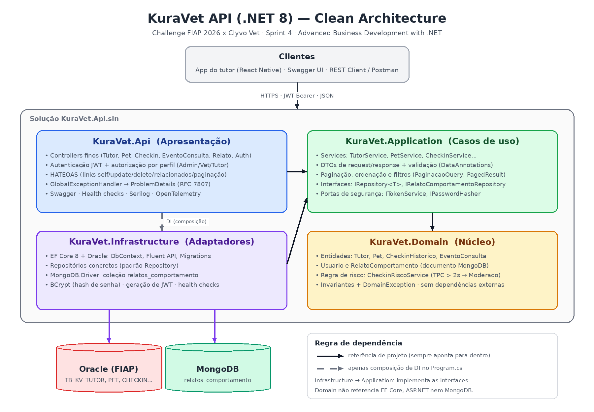
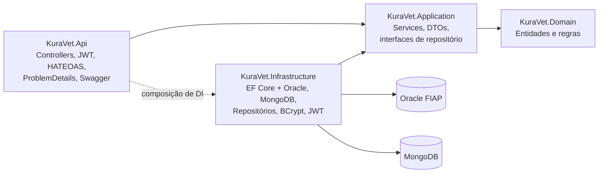

# KuraVet API — Advanced Business Development with .NET (Sprint 4)

API RESTful do **KuraVet**, plataforma de cuidado contínuo do pet (Challenge FIAP 2026 x Clyvo Vet).
Esta API cuida do lado **preventivo** da jornada: cadastro de tutores e pets, **check-ins de sinais vitais com
classificação automática de risco**, **linha do tempo clínica** (vacinas, exames, consultas) e **relatos de
comportamento** do pet (dados IoB armazenados no MongoDB, usados pela triagem por IA).

## Integrantes — Turma 2TDSPO

| Nome | RM |
|---|---|
| Guilherme Macedo Martins | RM562396 |
| Pedro Henrique Luiz Alves Duarte | RM563405 |
| Henrique Martins Oliveira | RM563620 |

---

## Sumário

1. [Arquitetura](#arquitetura)
2. [Tecnologias](#tecnologias)
3. [Estrutura do repositório](#estrutura-do-repositório)
4. [Como executar](#como-executar)
5. [Autenticação e perfis](#autenticação-e-perfis)
6. [Endpoints](#endpoints)
7. [Paginação, ordenação, filtros e HATEOAS](#paginação-ordenação-filtros-e-hateoas)
8. [Tratamento de erros](#tratamento-de-erros)
9. [Persistência (Oracle + MongoDB)](#persistência-oracle--mongodb)
10. [Monitoramento e observabilidade](#monitoramento-e-observabilidade)
11. [Testes e cobertura](#testes-e-cobertura)

---

## Arquitetura

A solução segue **Clean Architecture** com quatro projetos. As referências entre projetos sempre apontam para
dentro: o `Domain` não conhece EF Core, ASP.NET nem MongoDB.





| Projeto | Responsabilidade | Depende de |
|---|---|---|
| `KuraVet.Domain` | Entidades com invariantes (`Tutor`, `Pet`, `CheckinHistorico`, `EventoConsulta`, `Usuario`, `RelatoComportamento`), regra de risco (`CheckinRiscoService`) e `DomainException` | — |
| `KuraVet.Application` | Casos de uso (services), DTOs de request/response, filtros de paginação/ordenação e interfaces (`IRepository<T>`, `IRelatoComportamentoRepository`, `ITokenService`, `IPasswordHasher`) | Domain |
| `KuraVet.Infrastructure` | `KuraVetDbContext` (Oracle), configurações Fluent API, migrations, repositórios concretos, repositório MongoDB, BCrypt, geração de JWT e health checks dos bancos | Application |
| `KuraVet.Api` | Controllers finos, `GlobalExceptionHandler`, HATEOAS, autenticação JWT, Swagger, health checks, Serilog e OpenTelemetry | Application, Infrastructure |

### Decisões de design

- **Controllers finos**: só recebem a requisição, chamam o service e adicionam links HATEOAS. Nenhum controller acessa o `DbContext`.
- **SOLID**: cada service tem uma responsabilidade (SRP); os services dependem de abstrações (DIP), o que permite testá-los com Moq; repositórios específicos estendem `IRepository<T>` sem alterá-lo (OCP).
- **DI organizada em extension methods**: `AddApplication()`, `AddInfrastructure(configuration)`, `AddApiPresentation()`, `AddJwtAuthentication()`, `AddSwaggerDocumentation()`, `AddObservability()`.
- **Domain sem atributos de persistência**: o mapeamento das tabelas está em `IEntityTypeConfiguration<T>` (Fluent API) e o documento MongoDB tem uma classe própria (`RelatoComportamentoDocument`).
- **Regra de risco preservada da Sprint 3**: TPC acima de 2 segundos → `Moderado`; caso contrário → `Baixo`. O risco é recalculado a cada atualização.

---

## Tecnologias

.NET 8 · ASP.NET Core · EF Core 8 + Oracle (`Oracle.EntityFrameworkCore`) · MongoDB.Driver · JWT Bearer ·
BCrypt.Net-Next · Swashbuckle (Swagger) · Serilog · OpenTelemetry · xUnit · Moq · WebApplicationFactory · coverlet.

---

## Estrutura do repositório

```
KuraVet.Api.sln
├── KuraVet.Domain/                 Entidades, regras e exceções de domínio
├── KuraVet.Application/            Services, DTOs, filtros e interfaces (portas)
├── KuraVet.Infrastructure/
│   ├── Persistence/                DbContext, Configurations (Fluent), Repositories, Migrations
│   ├── Mongo/                      Documento, repositório e configurações do MongoDB
│   ├── Security/                   JwtTokenService, BCryptPasswordHasher, JwtSettings
│   └── HealthChecks/               Health checks do Oracle e do MongoDB
├── KuraVet.Api/
│   ├── Controllers/                Tutor, Pet, Checkin, EventoConsulta, RelatoComportamento, Auth
│   ├── ExceptionHandling/          GlobalExceptionHandler (ProblemDetails)
│   ├── Hateoas/                    Geração de links
│   ├── Extensions/                 Registro de serviços e endpoints
│   ├── HealthChecks/ Observability/ Middlewares/
│   └── Program.cs
├── KuraVet.Api.Tests.Unit/         Domain, Application e Infrastructure (xUnit + Moq + EF InMemory)
├── KuraVet.Api.Tests.Integration/  API completa via WebApplicationFactory + JWT de teste
├── docker-compose.yml              MongoDB local (com índices da coleção)
├── coverage.runsettings            Cobertura focada em Domain e Application
└── docs/                           Diagrama de arquitetura
```

---

## Como executar

### Pré-requisitos

- .NET SDK 8
- Acesso ao Oracle da FIAP (`oracle.fiap.com.br:1521/ORCL`)
- MongoDB: Docker (`docker compose up -d`) **ou** um cluster gratuito no MongoDB Atlas
- Ferramenta do EF: `dotnet tool install --global dotnet-ef --version 8.*`

### 1. Configurar os segredos (nunca versionados)

O `appsettings.json` contém apenas placeholders. Os valores reais ficam no **user-secrets** da máquina de cada
integrante (ou em variáveis de ambiente):

```bash
dotnet user-secrets set "ConnectionStrings:OracleConnection" "User Id=<RM>;Password=<SENHA>;Data Source=oracle.fiap.com.br:1521/ORCL;" --project KuraVet.Api
dotnet user-secrets set "MongoDb:ConnectionString" "mongodb://localhost:27017" --project KuraVet.Api
dotnet user-secrets set "Jwt:Key" "<uma-chave-aleatoria-com-32-ou-mais-caracteres>" --project KuraVet.Api
dotnet user-secrets set "Seed:Admin:Email" "<email-do-admin>" --project KuraVet.Api
dotnet user-secrets set "Seed:Admin:Senha" "<senha-do-admin>" --project KuraVet.Api
dotnet user-secrets list --project KuraVet.Api
```

Equivalentes em variáveis de ambiente: `ConnectionStrings__OracleConnection`, `MongoDb__ConnectionString`,
`Jwt__Key`, `Seed__Admin__Email`, `Seed__Admin__Senha`.

> O user-secrets só é carregado no ambiente `Development` (padrão dos perfis `http`/`https`).
> Sem `Jwt:Key` válida a API **não inicia** e informa o motivo no console.

### 2. MongoDB

```bash
docker compose up -d          # sobe o MongoDB 7 em localhost:27017 e cria os índices de relatos_comportamento
```

Para usar o **Atlas**, crie um cluster gratuito, libere seu IP e grave a connection string `mongodb+srv://...` em
`MongoDb:ConnectionString` via user-secrets.

### 3. Aplicar as migrations no Oracle

```bash
dotnet ef database update --project KuraVet.Infrastructure --startup-project KuraVet.Api
```

Migrations existentes: `CriacaoTabelasKuraVet`, `AdicionaEventoConsulta` (Sprint 2/3) e `AdicionaUsuario` (Sprint 4).
Para conferir se o modelo está sincronizado com as migrations:

```bash
dotnet ef migrations has-pending-model-changes --project KuraVet.Infrastructure --startup-project KuraVet.Api
```

### 4. Executar

```bash
dotnet run --project KuraVet.Api --launch-profile http
```

- Swagger: <http://localhost:5180/swagger>
- Health check: <http://localhost:5180/health>
- Na inicialização, o administrador configurado em `Seed:Admin` é criado (se ainda não existir).

O arquivo `KuraVet.Api/KuraVet.Api.http` tem requisições prontas para o fluxo completo.

---

## Autenticação e perfis

1. `POST /api/auth/login` com e-mail e senha → retorna `accessToken` (JWT, 60 min).
2. Envie o token no header `Authorization: Bearer <token>` (no Swagger, botão **Authorize**).
3. Senhas são armazenadas apenas como **hash BCrypt** (`TB_KV_USUARIO.SenhaHash`).

| Perfil | Como é criado | Permissões |
|---|---|---|
| `Tutor` | `POST /api/auth/register` (autocadastro) | Consultar e cadastrar/editar tutores, pets, check-ins e relatos |
| `Veterinario` | Admin via `POST /api/auth/usuarios` | Tudo do Tutor + criar/editar eventos clínicos |
| `Admin` | Seed na inicialização ou outro Admin | Tudo, incluindo exclusões e gestão de usuários |

Health checks e login/registro são públicos; todas as demais rotas exigem token.

---

## Endpoints

| Método | Rota | Descrição | Perfil |
|---|---|---|---|
| POST | `/api/auth/login` | Autentica e emite JWT | Público |
| POST | `/api/auth/register` | Autocadastro (perfil Tutor) | Público |
| GET | `/api/auth/me` | Usuário autenticado | Autenticado |
| POST | `/api/auth/usuarios` | Cria usuário com perfil escolhido | Admin |
| GET | `/api/auth/usuarios/{id}` | Obtém usuário | Admin |
| GET | `/api/Tutor` | Lista tutores (paginado; filtro `nome`) | Autenticado |
| GET | `/api/Tutor/{id}` | Obtém tutor | Autenticado |
| POST | `/api/Tutor` | Cria tutor | Autenticado |
| PUT | `/api/Tutor/{id}` | Atualiza tutor | Autenticado |
| DELETE | `/api/Tutor/{id}` | Remove tutor (cascade nos pets) | Admin |
| GET | `/api/Pet` | Lista pets (filtros `nome`, `tutorId`) | Autenticado |
| GET | `/api/Pet/{id}` | Obtém pet | Autenticado |
| GET | `/api/Pet/tutor/{tutorId}` | Pets de um tutor | Autenticado |
| POST | `/api/Pet` | Cria pet | Autenticado |
| PUT | `/api/Pet/{id}` | Atualiza pet | Autenticado |
| DELETE | `/api/Pet/{id}` | Remove pet | Admin |
| GET | `/api/Checkin` | Lista check-ins (filtros `petId`, `nivelRisco`, `dataInicio`, `dataFim`) | Autenticado |
| GET | `/api/Checkin/{id}` | Obtém check-in | Autenticado |
| GET | `/api/Checkin/pet/{petId}` | Histórico do pet (mais recentes primeiro) | Autenticado |
| GET | `/api/Checkin/risco/{nivelRisco}` | Check-ins por risco (Baixo, Moderado, Grave) | Autenticado |
| POST | `/api/Checkin` | Registra check-in e classifica o risco | Autenticado |
| PUT | `/api/Checkin/{id}` | Atualiza e recalcula o risco | Autenticado |
| DELETE | `/api/Checkin/{id}` | Remove check-in | Admin |
| GET | `/api/EventoConsulta` | Lista eventos (filtros `petId`, `tipoEvento`, `veterinario`, datas) | Autenticado |
| GET | `/api/EventoConsulta/{id}` | Obtém evento | Autenticado |
| GET | `/api/EventoConsulta/pet/{petId}` | Linha do tempo clínica do pet | Autenticado |
| POST | `/api/EventoConsulta` | Registra evento | Admin, Veterinario |
| PUT | `/api/EventoConsulta/{id}` | Atualiza evento | Admin, Veterinario |
| DELETE | `/api/EventoConsulta/{id}` | Remove evento | Admin |
| GET | `/api/RelatoComportamento` | Lista relatos (filtros `petId`, `categoria`, `intensidadeMinima`, datas) | Autenticado |
| GET | `/api/RelatoComportamento/{id}` | Obtém relato (ObjectId) | Autenticado |
| POST | `/api/RelatoComportamento` | Registra relato (MongoDB) | Autenticado |
| PUT | `/api/RelatoComportamento/{id}` | Atualiza relato | Autenticado |
| DELETE | `/api/RelatoComportamento/{id}` | Remove relato | Admin |
| GET | `/health`, `/health/live`, `/health/ready` | Health checks | Público |

A especificação OpenAPI completa fica disponível em `/swagger/v1/swagger.json` com a API em execução
(exportada em [`docs/openapi.json`](docs/openapi.json)).

---

## Paginação, ordenação, filtros e HATEOAS

Todos os `GET` de listagem aceitam:

| Parâmetro | Padrão | Observação |
|---|---|---|
| `page` | 1 | Valores menores que 1 viram 1 |
| `pageSize` | 10 | Máximo 100 |
| `sortBy` | por recurso | Campo inválido retorna 400 com os valores aceitos |
| `sortDir` | `asc` (check-ins, eventos e relatos: `desc`) | `asc` ou `desc` |
| filtros | — | Específicos de cada recurso (tabela de endpoints) |

Exemplo: `GET /api/Tutor?page=1&pageSize=2&sortBy=nome&sortDir=asc&nome=ana`

```json
{
  "items": [
    {
      "id": 3,
      "nome": "Ana Souza",
      "links": [
        { "rel": "self", "href": "http://localhost:5180/api/Tutor/3", "method": "GET" },
        { "rel": "update", "href": "http://localhost:5180/api/Tutor/3", "method": "PUT" },
        { "rel": "delete", "href": "http://localhost:5180/api/Tutor/3", "method": "DELETE" },
        { "rel": "pets", "href": "http://localhost:5180/api/Pet/tutor/3", "method": "GET" }
      ]
    }
  ],
  "page": 1,
  "pageSize": 2,
  "totalItems": 3,
  "totalPages": 2,
  "links": [
    { "rel": "self", "href": "http://localhost:5180/api/Tutor?nome=ana&page=1&pageSize=2&sortBy=nome&sortDir=asc", "method": "GET" },
    { "rel": "first", "href": "...page=1...", "method": "GET" },
    { "rel": "last", "href": "...page=2...", "method": "GET" },
    { "rel": "next", "href": "...page=2...", "method": "GET" }
  ]
}
```

Links relacionados por recurso: **pet** → `tutor`, `checkins`, `timeline`, `relatos`; **check-in**, **evento** e
**relato** → `pet`; **tutor** → `pets`.

---

## Tratamento de erros

Um `IExceptionHandler` global converte todas as exceções em **ProblemDetails (RFC 7807)**:

| Situação | Status |
|---|---|
| Validação de DTO (DataAnnotations), regra de domínio, `sortBy` inválido, referência inexistente | 400 |
| Credenciais inválidas / sem token | 401 |
| Perfil sem permissão | 403 |
| Recurso não encontrado | 404 |
| E-mail já cadastrado, violação de restrição do banco | 409 |
| Erro inesperado (sem detalhes internos) | 500 |

```json
{
  "type": "https://httpstatuses.io/404",
  "title": "Recurso não encontrado",
  "status": 404,
  "detail": "Tutor '99' não encontrado(a).",
  "instance": "/api/Tutor/99",
  "traceId": "0HN7..."
}
```

---

## Persistência (Oracle + MongoDB)

**Oracle (EF Core + migrations)** — tabelas `TB_KV_TUTOR`, `TB_KV_PET`, `TB_KV_CHECKIN_HISTORICO`,
`TB_KV_EVENTO_CONSULTA` e `TB_KV_USUARIO`, com chaves estrangeiras em cascata e índice único em `Email`.
O schema usado por esta API é diferente do schema do backend Java (os dois possuem tabelas de tutor e pet).

**MongoDB** — coleção `relatos_comportamento`. Relatos de comportamento são textos livres com categoria,
intensidade (1–5) e tags variáveis: um formato semiestruturado que muda com frequência e é lido em bloco pela
triagem por IA, por isso faz mais sentido em um banco de documentos do que em tabelas relacionais.

```json
{
  "_id": { "$oid": "652f1c2e9b1e8a0012345678" },
  "petId": 1,
  "categoria": "Alimentacao",
  "descricao": "Comeu metade da ração e bebeu menos água que o normal.",
  "intensidade": 3,
  "tags": ["apetite", "agua"],
  "dataRelato": { "$date": "2026-10-04T21:10:00Z" },
  "registradoPor": "tutor@kuravet.com",
  "criadoEm": { "$date": "2026-10-04T21:12:30Z" }
}
```

**Padrão Repository** — `IRepository<T>` e interfaces específicas ficam na Application; as implementações
(`TutorRepository`, `PetRepository`, `CheckinRepository`, `EventoConsultaRepository`, `UsuarioRepository` e
`RelatoComportamentoRepository`) ficam na Infrastructure.

---

## Monitoramento e observabilidade

| Recurso | Detalhes |
|---|---|
| Health checks | `/health` (todos), `/health/live` (processo), `/health/ready` (Oracle, MongoDB e memória). Oracle fora do ar → `Unhealthy`; MongoDB fora do ar → `Degraded` |
| Logs estruturados | Serilog no console e em `logs/kuravet-api-AAAAMMDD.log`, com `CorrelationId` em todas as linhas |
| Correlação | Header `X-Correlation-Id` em todas as respostas e `traceId` nos ProblemDetails |
| Tracing e métricas | OpenTelemetry (ASP.NET Core, HttpClient e métricas próprias `kuravet_api_requests_total`, `kuravet_api_requests_errors_total`, `kuravet_api_request_duration_ms`) com exporter de console |

---

## Testes e cobertura

```bash
dotnet build
dotnet test
```

- **Unitários** (`KuraVet.Api.Tests.Unit`): entidades e regra de risco (Domain), services com repositórios
  mockados via Moq (Application), BCrypt, JWT e paginação do repositório com EF InMemory (Infrastructure).
- **Integração** (`KuraVet.Api.Tests.Integration`): a API completa sobe com `WebApplicationFactory`, Oracle
  trocado por EF InMemory e MongoDB por um repositório em memória. Os testes usam JWT real emitido pela própria
  API e cobrem autenticação (401/403), CRUD, paginação, HATEOAS, ProblemDetails e health checks.
  Nenhum banco externo é necessário para rodar `dotnet test`.
- Padrão de nomes: `Metodo_Cenario_ResultadoEsperado`, estrutura AAA (Arrange, Act, Assert).

### Cobertura (Domain + Application)

```bash
dotnet test --collect:"XPlat Code Coverage" --settings coverage.runsettings
dotnet tool install --global dotnet-reportgenerator-globaltool
reportgenerator -reports:"**/TestResults/**/coverage.cobertura.xml" -targetdir:"docs/coverage" -reporttypes:"TextSummary;Html"
```

| Camada | Cobertura de linhas |
|---|---|
| KuraVet.Domain | **PREENCHER** % |
| KuraVet.Application | **PREENCHER** % |

(valores extraídos de `docs/coverage/Summary.txt`)
